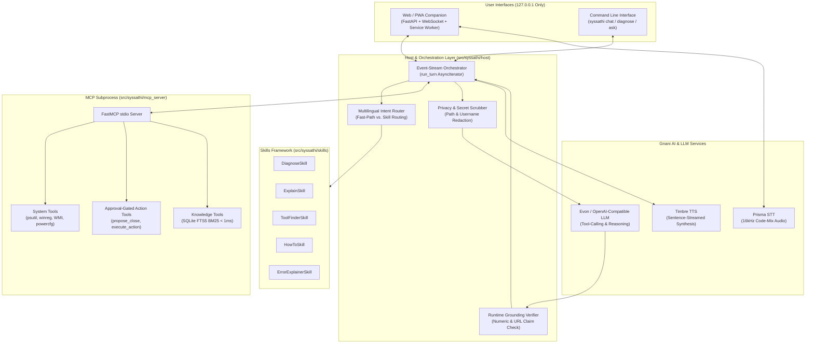

# SysSathi ⚡

> **A multilingual, voice-and-text Windows diagnostic and tech-literacy companion.**


**SysSathi** (*System Companion*) combines local hardware diagnostics, an offline-capable curated knowledge base, and Gnani AI's speech & reasoning stack (**Prisma STT**, **Timbre TTS**, and **Evon LLM**). It helps users understand *why* their PC is slow, explains computing concepts using relatable everyday analogies, recommends verified software with download-safety guidance, and troubleshoots Windows errors in **12 Indic languages and English** (both native script and Romanized code-mix like Hinglish or Tanglish).

---

## 📖 Table of Contents

- [Core Principles](#-core-principles)
- [Key Capabilities & Skills](#-key-capabilities--skills)
- [System Architecture](#-system-architecture)
- [Supported Languages](#-supported-languages)
- [Quick Start (Windows-First)](#-quick-start-windows-first)
- [Configuration (`.env`)](#-configuration-env)
- [Usage Guide (Web PWA & CLI)](#-usage-guide-web-pwa--cli)
- [MCP Tools & Safety Model](#-mcp-tools--safety-model)
- [Privacy & Data Redaction](#-privacy--data-redaction)
- [Project Structure](#-project-structure)
- [Testing & Verification](#-testing--verification)
- [Documentation](#-documentation)

---

## 🎯 Core Principles

1. **Teach, Don't Just Do:** Every turn explains *why* an issue happens using everyday analogies (e.g., comparing RAM to desk workspace and disk storage to a filing cabinet) and surfaces structured **Lesson Cards** with keyboard shortcuts (like `Ctrl + Shift + Esc` for Task Manager).
2. **Grounded or Silent:** Every numeric claim is verified at runtime against real hardware measurements (`psutil` / WMI), and every URL or software recommendation must originate from verified local knowledge sources (**FMHY**, **Wikipedia**, **Microsoft Learn**, **EFF SSD**). Hallucinated numbers and unverified URLs are automatically stripped or rejected.
3. **Native Language & Code-Mix First:** Supports 12 languages across native scripts and Romanized Latin scripts (e.g., *"Mera laptop slow kyun chal raha hai?"*), with zero-latency voice filler acknowledgments and sentence-streamed TTS.
4. **Safe by Default (Human-in-the-Loop):** Read-only diagnostics and knowledge lookups run freely. State-changing actions (like closing heavy applications) require an explicit UI click on a **60-second expiring proposal** bound by a cryptographic session nonce. **Voice can cancel, but can never approve destructive actions.**
5. **Educate, Don't Block:** Community knowledge entries carry transparent risk labels (`SAFE` vs. `CAUTION`), neutral legal context, and practical download-hygiene tips rather than opaque censorship.
6. **Built for Weak Hardware & Weak Internet:** Runs strictly on `127.0.0.1` with a sub-millisecond embedded **SQLite FTS5 (BM25)** knowledge index and deterministic offline fallbacks when remote APIs are unreachable.

---

## 🧠 Key Capabilities & Skills

SysSathi routes user queries through a multilingual intent router to five specialized domain skills:

| Skill | Purpose | Example Query | Lesson Card & Output |
| :--- | :--- | :--- | :--- |
| **`DiagnoseSkill`** | Samples CPU, RAM, Disk, Battery health, and Startup apps over a 2-pass window; proposes closing heavy tasks if needed. | *"Mera laptop bahut hang ho raha hai"* | Explains RAM vs. CPU bottlenecks; offers a 60s approval card to close heavy process trees. |
| **`ExplainSkill`** | Breaks down computer jargon into everyday analogies. | *"RAM aur SSD mein kya farak hai?"* | Desk surface vs. cupboard analogy + how to check specs in Task Manager. |
| **`ToolFinderSkill`** | Recommends vetted, ad-free software from curated directories. | *"Photo edit karne ke liye free software batao"* | Cites verified links with risk level badges and installer safety tips. |
| **`HowToSkill`** | Provides step-by-step Windows guides and keyboard shortcuts. | *"Startup apps kaise band karein?"* | Step-by-step walkthrough + direct Windows shortcut tips. |
| **`ErrorExplainerSkill`** | Translates cryptic Windows/system error codes into plain language. | *"BSOD error 0x0000007E ka matlab kya hai?"* | Plain-language root cause + safe troubleshooting steps. |

---

## 🏗️ System Architecture



---

## 🌐 Supported Languages

SysSathi supports all 12 Gnani Vachana languages out of the box with script auto-detection, native punctuation splitting, and customizable Latin/native output styles:

| Code | Language | Native Name | Supported Scripts | Default TTS Voice |
| :---: | :--- | :--- | :--- | :--- |
| `hi` | Hindi | हिन्दी | Devanagari, Latin (Hinglish) | Shivani |
| `en` | English | English | Latin | Shivani |
| `bn` | Bengali | বাংলা | Bengali, Latin | Shivani |
| `ta` | Tamil | தமிழ் | Tamil, Latin (Tanglish) | Kavitha |
| `te` | Telugu | తెలుగు | Telugu, Latin | Shivani |
| `mr` | Marathi | मराठी | Devanagari, Latin | Shivani |
| `gu` | Gujarati | ગુજરાતી | Gujarati, Latin | Shivani |
| `kn` | Kannada | ಕನ್ನಡ | Kannada, Latin | Shivani |
| `ml` | Malayalam | മലയാളം | Malayalam, Latin | Shivani |
| `pa` | Punjabi | ਪੰਜਾਬੀ | Gurmukhi, Latin | Shivani |
| `or` | Odia | ଓଡ଼ିଆ | Odia, Latin | Shivani |
| `ur` | Urdu | اردو | Arabic, Latin | Shivani |

---

## 🚀 Quick Start (Windows-First)

### Prerequisites
- **OS:** Windows 10 (1903+) or Windows 11 (64-bit)
- **Python:** Python 3.11 or 3.12 (`py -3.12 --version`)
- **Browser:** Edge, Chrome, or Firefox (for the Web PWA interface)

> **Why Native Windows?** SysSathi inspects real Windows hardware counters (`psutil`), Registry startup flags (`winreg`), and battery health (`WMI` / `powercfg`). Running inside WSL will only measure the Linux VM rather than your host Windows PC.

### 1. Set Up Virtual Environment
Open **PowerShell** in the project root:

```powershell
# Create and activate a Python 3.12 virtual environment
py -3.12 -m venv .venv
.\.venv\Scripts\Activate.ps1

# Install SysSathi in editable mode with dev/test dependencies
pip install -e ".[dev]"
```

### 2. Configure Environment Variables
Copy the template `.env.example` to `.env`:

```powershell
Copy-Item .env.example .env
```

For immediate **offline / demo testing** (no API keys required), set `SYSSATHI_LLM_BACKEND=mock` in `.env`. For live voice and LLM inference, add your Gnani and Evon credentials (see [Configuration](#-configuration-env) below).

### 3. Launch SysSathi

#### Option A: Interactive Web / PWA Companion
```powershell
python scripts/windows_launcher.py
# Or double-click scripts\run_syssathi.bat
# Or run directly with uvicorn:
uvicorn syssathi.web.app:app --host 127.0.0.1 --port 8000
```
Open **`http://127.0.0.1:8000`** in your browser. You can use Push-to-Talk or Tap-to-Toggle voice input, text chat, language switching, and one-click action approvals.

#### Option B: Command Line Interface (CLI)
```powershell
# Start interactive conversational mode
syssathi chat --lang hi

# Run an instant hardware, battery, and startup diagnostic report
syssathi diagnose

# Ask a single question with grounded citations & lesson card
syssathi ask "Mera laptop slow kyun hai?" --lang hi --script latin
```

---

## ⚙️ Configuration (`.env`)

SysSathi loads settings lazily via `pydantic-settings` from `.env` in your working directory, repository root, or user config directory:

| Variable | Default | Description |
| :--- | :--- | :--- |
| `SYSSATHI_LLM_BACKEND` | `mock` (in tests) | LLM backend: `evon_remote`, `openai_compatible`, or `mock` (offline deterministic mode). |
| `EVON_BASE_URL` | `""` | Base URL for the remote Evon vLLM endpoint. |
| `HF_TOKEN` | `""` | Hugging Face / Bearer token for authenticating with the Evon endpoint. |
| `EVON_MODEL` | `""` | Model identifier on the Evon server. |
| `OPENAI_COMPAT_BASE_URL` | `""` | Fallback OpenAI-compatible API endpoint URL. |
| `OPENAI_COMPAT_API_KEY` | `""` | API key for the OpenAI-compatible fallback endpoint. |
| `OPENAI_COMPAT_MODEL` | `""` | Model name for the OpenAI-compatible fallback endpoint. |
| `GNANI_API_KEY` | `""` | Gnani Vachana API key for **Prisma STT** and **Timbre TTS**. |
| `PRISMA_MODE` | `Code-mix` | Prisma STT transcription mode. |
| `TIMBRE_VOICE` | `Shivani` | Default Timbre TTS voice profile. |
| `REPLY_STYLE` | `latin` | Default script output preference (`latin` for Hinglish/Romanized, `devanagari` for native). |
| `ENABLE_FAST_PATH` | `true` | Enables deterministic fast-path diagnostics for slowness queries. |
| `ENABLE_TELEMETRY` | `false` | Opt-in local latency and turn-timing logs stored on disk. |
| `SYSSATHI_RAM_HIGH_PCT` | `80` | Custom threshold override (%) for high RAM usage alerts. |
| `SYSSATHI_CPU_HIGH_PCT` | `75` | Custom threshold override (%) for high CPU usage alerts. |
| `SYSSATHI_DISK_LOW_PCT` | `10` | Custom threshold override (%) for low free disk space alerts. |
| `SYSSATHI_STARTUP_HIGH_COUNT` | `10` | Custom threshold override for excessive enabled startup apps. |
| `SYSSATHI_EXTRA_PROTECTED` | `""` | Comma-separated list of additional process names to protect from termination. |

---

## 🛠️ Usage Guide (Web PWA & CLI)

### CLI Subcommands

| Command | Description |
| :--- | :--- |
| `syssathi chat [--lang hi]` | Starts the interactive conversational companion in your terminal. |
| `syssathi diagnose` | Samples CPU, RAM, Disk, Battery health, and Startup apps in real time. |
| `syssathi ask "<query>" [--lang hi] [--script latin\|native]` | Single-turn grounded response with lesson cards and verified source citations. |
| `syssathi index [status\|update]` | Verifies the local SQLite FTS5 knowledge base and prints its SHA-256 manifest digest. |
| `syssathi eval` | Executes the multi-step end-to-end evaluation benchmark suite. |
| `syssathi telemetry` | Displays the local turn-latency and performance telemetry dashboard. |

### Interactive Chat Slash Commands (`syssathi chat`)
Inside an interactive CLI chat session, you can use:
- `/approve` — Approve a pending 60-second process termination proposal.
- `/status` — Inspect active LLM backend, MCP subprocess health, language, and pending proposals.
- `/lang <latin|devanagari|native>` — Switch reply script style on the fly.
- `/help` — Show available interactive commands.
- `/quit` or `/exit` — Exit the companion.

---

## 🔒 MCP Tools & Safety Model

SysSathi isolates OS inspection and knowledge retrieval inside a dedicated **FastMCP subprocess** (`syssathi-mcp`) communicating over `stdio` with automatic crash recovery and strict execution timeouts.

### 1. Read-Only Tools (Unrestricted)
- **System Diagnostics:**
  - `diagnose_slowness`: Two-pass CPU, RAM, disk, and process tree sampler.
  - `get_top_processes`: Aggregates memory and CPU across child process groups.
  - `list_startup_apps`: Inspects `HKCU`/`HKLM` Run keys and filters out disabled apps via `StartupApproved\Run`.
  - `get_battery_report`: Reads WMI `BatteryStaticData` with automatic unprivileged fallback to `powercfg /batteryreport`.
- **Knowledge Retrieval:**
  - `search_sources`: Sub-millisecond BM25 full-text query against the local SQLite FTS5 index.
  - `get_tool_recommendations`: Retrieves curated software tools with `RiskLevel` badges and safety notes.
  - `explain_term`: Fetches structured plain-language explanations and analogies for computing terms.

### 2. State-Changing Tools (Two-Phase Approval Gated)
- `propose_close`: Generates a single-use `action_id` targeting a verified heavy process group, valid for **60 seconds**, recording exact target PIDs and process creation timestamps.
- `execute_action`: Requires an explicit HTTP `POST /api/approve` with a session-bound cryptographic nonce (`X-SysSathi-Nonce`) and internal approval token. At execution time, every PID is re-verified against its creation timestamp to prevent PID-recycling hazards, and post-action RAM recovery is immediately re-measured.

### 3. Protected Process Blocklist
Critical Windows and runtime processes (`system`, `svchost`, `lsass`, `csrss`, `wininit`, `winlogon`, `explorer`, `dwm`, `msmpeng`, `securityhealthservice`, `python`, etc.) are hard-blocked at the MCP boundary and can never be proposed or terminated.

---

## 🛡️ Privacy & Data Redaction

SysSathi is engineered with privacy-first guardrails (`src/syssathi/core/privacy.py`):
- **Localhost Only:** The FastAPI server and WebSocket endpoints bind strictly to `127.0.0.1`. No external accounts or cloud telemetry exist.
- **Automatic Path & Username Scrubbing:** Windows (`C:\Users\<username>\...`) and Unix (`/home/<username>/...`, `/Users/<username>/...`) paths—as well as standalone occurrences of the logged-in OS username—are automatically redacted to `<user>` before any text leaves your machine.
- **Secret Scrubbing:** API tokens (`gnani_*`, `hf_*`, `sk-*`, `Bearer ...`) are automatically scrubbed from logs and outgoing payloads.
- **Terminal & Prompt Anti-Injection:** Process names, window titles, and registry strings are sanitized to strip C0/C1 control characters and Unicode `Cf` bidirectional override characters (`\u202E`).

---

## 📂 Project Structure

```text
gnani/
├── docs/                       # Architecture, Safety, Windows Dev, and Demo guides
├── scripts/                    # Windows launcher, batch runner, MCP smoke tests, and eval runners
├── src/syssathi/
│   ├── core/                   # Privacy redaction, i18n catalog, 12-language registry, telemetry, WSL check
│   ├── eval/                   # Multi-step evaluation scenarios and benchmark runner
│   ├── host/                   # CLI entrypoint, Orchestrator event stream, Intent Router, LLM client, Config
│   ├── knowledge/              # SQLite FTS5 BM25 index, curated seeds, risk labeling, SHA-256 manifest ingest
│   ├── mcp_server/             # FastMCP stdio server, Windows system tools, process guardrails, input sanitizer
│   ├── skills/                 # Modular skills (Diagnose, Explain, ToolFinder, HowTo, ErrorExplainer)
│   ├── voice/                  # Gnani Prisma STT, Timbre TTS, Unicode sentence splitter, local filler cache
│   ├── web/                    # FastAPI server, WebSocket handler, nonce confirmation gate, PWA static assets
│   ├── grounding.py            # Runtime numeric and URL claim verification engine
│   └── schemas.py              # Shared Pydantic data contracts
├── tests/                      # 251 unit & integration tests across 19 test modules
├── .env.example                # Environment variable template
└── pyproject.toml              # Package metadata, dependencies, and CLI entrypoints
```

---

## 🧪 Testing & Verification

SysSathi includes **251 automated tests** across 19 test suites covering unit logic, grounding verification, privacy redaction, security nonces, MCP tools, skills, multilingual routing, and PWA endpoints.

```powershell
# Run the complete test suite
.\.venv\Scripts\python.exe -m pytest tests/ -v

# Run the live Windows MCP hardware smoke test
.\.venv\Scripts\python.exe scripts/mcp_smoke.py

# Run the multi-step evaluation suite
syssathi eval
```

---

## 📚 Documentation

- [System Architecture](docs/ARCHITECTURE.md) — Detailed Mermaid diagrams, event stream lifecycle, and subsystem breakdown.
- [Safety & Source Policy](docs/SAFETY.md) — Two-phase action authorization, protected process blocklist, and "Educate, Don't Block" risk labeling.
- [Live Demo Script](docs/DEMO.md) — Step-by-step walkthrough for demonstrating push-to-talk diagnosis and one-click RAM recovery.
- [Windows Native Development](docs/WINDOWS_DEV.md) — Hardware counter details (`WMI`, `powercfg`, `winreg`) and PowerShell workflow.
- [Contributing & Extension Guide](docs/CONTRIBUTING.md) — How to add new languages, author new skills, and ingest curated knowledge sources.
