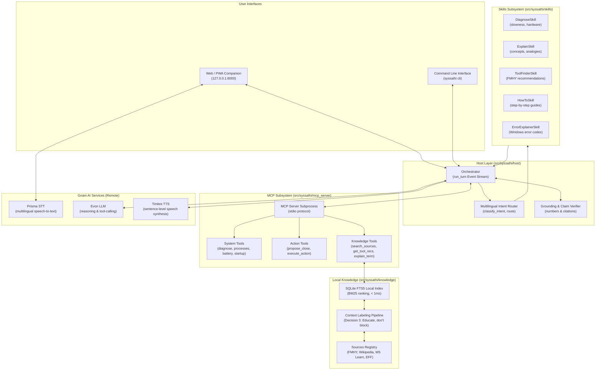

# SysSathi Architecture ⚡

SysSathi is an offline-capable, multilingual companion designed to diagnose PC issues, teach computing concepts, and recommend curated software tools.

---

## 1. High-Level Architecture

---

## 2. Component Subsystems

### 2.1 Core Subsystem (`src/syssathi/core/`)
- **`settings.py`**: Cached Pydantic v2 application settings loaded lazily from `.env` and environment variables.
- **`languages.yaml` & `languages.py`**: Central registry of all 12 Gnani Vachana supported languages (Hindi, English, Bengali, Tamil, Telugu, Marathi, Gujarati, Kannada, Malayalam, Punjabi, Odia, Urdu) with script detection, default voices, and delimiters.
- **`privacy.py`**: Local redaction engine scrubbing Windows user profile directories (`C:\Users\<user>\...`) and usernames before external API transmission.
- **`wsl.py`**: Linux VM / WSL detection engine protecting against false host hardware metrics.

### 2.2 Host & Orchestration (`src/syssathi/host/`)
- **`Orchestrator`**: Central event-driven coordinator executing turns as an asynchronous event stream:
  `async def run_turn(session, user_input) -> AsyncIterator[Event]`
  Emits: `route`, `filler`, `status`, `tool_call`, `tool_result`, `sources`, `lesson_card`, `proposal`, `sentence`, `reply`, and `done`.
- **`router.py`**: Multilingual intent classifier mapping user queries to `fast` diagnostic path or `evon` skill routing.
- **`grounding.py`**: Runtime verification enforcing that all numbers match measured tool data and all cited URLs originated in verified tool outputs.

### 2.3 Skills Framework (`src/syssathi/skills/`)
Implements Principle 1: **"Teach, don't just do."**
- Every skill implements `BaseSkill` with `get_tools()`, `get_system_prompt()`, `build_lesson_card()`, and `format_deterministic_fallback()`.
- Produces structured `LessonCard` instances (e.g., RAM desk space analogy, download safety guidelines, Task Manager shortcuts).

### 2.4 MCP Server & Tools (`src/syssathi/mcp_server/`)
- Runs as an independent process managed by `MCPClient` over standard input/output (`stdio`).
- Automatically restarts on subprocess crashes with strict timeouts (10s for diagnosis, 5s for queries).
- Exposes 9 tools:
  - System: `diagnose_slowness`, `get_top_processes`, `list_startup_apps`, `get_battery_report`
  - Action (approval-gated): `propose_close`, `execute_action`
  - Knowledge (read-only): `search_sources`, `get_tool_recommendations`, `explain_term`

### 2.5 Knowledge Base (`src/syssathi/knowledge/`)
- **Sub-Millisecond Offline Search**: Embedded SQLite database utilizing the FTS5 virtual table (`chunks_fts`) with BM25 ranking.
- **Principle 3 (Educate, don't block)**: All entries from community directories (FMHY, Wikipedia, Microsoft Learn, EFF SSD) are searchable. Entries carry transparent context notes, neutral legal explanations, and verified safety tips.

### 2.6 Speech Pipeline (`src/syssathi/voice/`)
- **Prisma STT**: In-memory 16kHz audio transcription with language hints.
- **Timbre TTS**: Sentence-level streaming playback via `SentenceSplitter` using Unicode sentence boundaries.
- **Filler Cache**: Pre-synthesized local audio cache for zero-latency acknowledgment playback ("Ek second, check karta hoon...").

---

## 3. Security & Safety Model

1. **Local-Only Binding**: FastAPl server and WebSocket endpoints bind strictly to `127.0.0.1`.
2. **Action Token Lifecycle**:
   - `propose_close` generates a single-use `action_id`.
   - Expires automatically after 60 seconds.
   - Requires explicit HTTP POST to `/api/approve` carrying a session-bound cryptographic nonce.
   - Voice commands can cancel, but **never approve**.
3. **Protected Process Safeguards**: Operating system processes (`explorer`, `svchost`, `system`, Python runtime) cannot be proposed or terminated.

